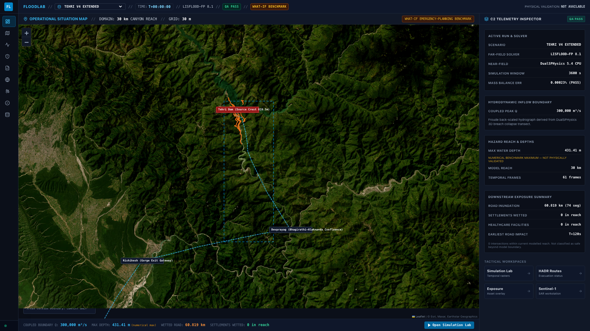
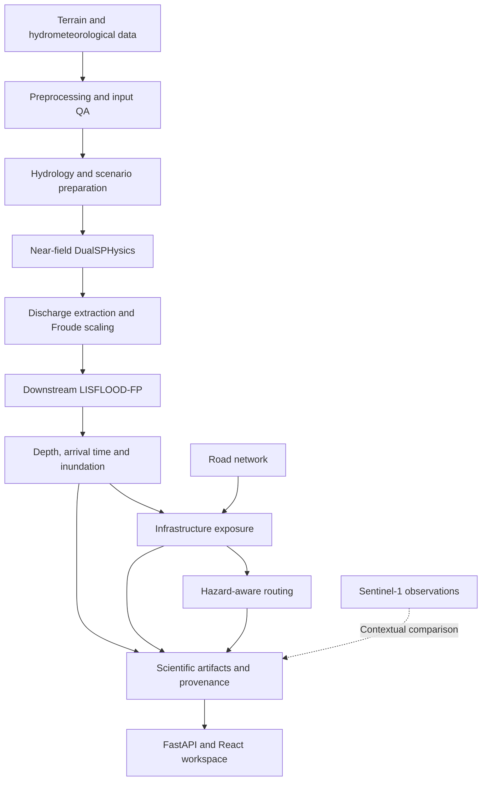
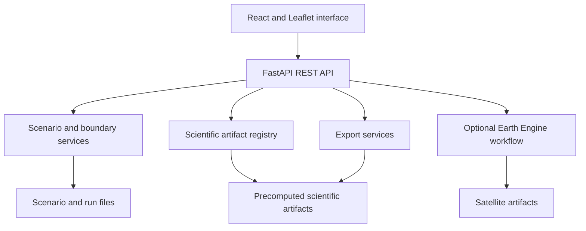

# INDRA — India's National Disaster Response Architect

**Flood simulation, infrastructure exposure, and emergency-route planning.**

INDRA connects physics-based flood modelling with geospatial analysis to help planners explore **where flooding may occur, when roads could become unavailable, and whether affected areas remain reachable**.

The reference case is the **Tehri Dam–Bhagirathi River system in Uttarakhand, India**, developed in the SIH 2026 disaster-management context.

> **Project status:** Research and emergency-planning prototype. The catastrophic Tehri breach is a hypothetical scenario, not a historical event or an operational forecast. The current core is physics-based; ML-assisted scenario exploration is a proposed extension.



## The problem

During a dam-break or sudden-release emergency, a flood outline alone does not answer the questions response teams face:

- Which locations may be inundated, and how soon?
- Which roads and critical facilities intersect the modelled hazard?
- Could a road flood before a response team completes its journey?
- Is there an alternative route, or is the destination unreachable under the scenario?
- Which conclusions come from observations, assumptions, or numerical models?

INDRA brings those questions into one workflow. Its longer-term goal includes identifying communities that could become isolated when their access roads flood, even before water reaches the settlements themselves.

## What INDRA does

| Capability | Purpose |
| --- | --- |
| **Scenario preparation** | Define breach, natural-blockage, or controlled-release inputs and generate boundary hydrographs. Generalized scenario control remains a prototype. |
| **Multi-scale modelling** | Connect near-field DualSPHysics discharge with downstream LISFLOOD-FP inundation modelling. |
| **Flood playback** | Explore depth frames, arrival time, and flood extent when the corresponding model artifacts are available. |
| **Exposure analysis** | Intersect modelled flooding with roads, settlements, healthcare, bridges, and power assets. |
| **Hazard-aware routing** | Compare ordinary routes with alternatives that account for flood timing and road availability. |
| **Satellite observation** | Run credential-gated Sentinel-1 surface-water-change analysis through Google Earth Engine. |
| **Scientific inspection** | Inspect model assumptions, provenance, calibration metrics, and numerical QA. |
| **GIS exports** | Export available products as GeoTIFF, GeoJSON, Shapefile ZIP, KML, or CSV, depending on the product. |

The interface includes a Command Center, Simulation Lab, Scenario Builder, Exposure workspace, HADR routing, Satellite Monitor, and Models & QA views. HADR means **Humanitarian Assistance and Disaster Relief**.

## Architecture

The proposed next-generation design is documented in the [complete system design](docs/system_design.md), covering continuous observation ingestion, satellite monitoring, CV, physics/ML prediction, infrastructure isolation, rescue missions, cloud deployment and voice access. The [integration architecture](docs/hackathon_architecture.md) details credentials, sponsor services and the demonstration workflow. These are implementation plans; the current capabilities and limitations below remain applicable.

### Modelling and decision workflow



This represents the scientific workflow. Normal web startup serves stored artifacts; it does **not** automatically rerun the complete solver chain. The theoretical breach benchmark includes simplified assumptions and is not a calibrated model of a real Tehri failure.

### Why two hydraulic solvers?

| Stage | Method | Responsibility |
| --- | --- | --- |
| Hydrology | Conceptual rainfall-runoff modelling | Estimate event inflow; the benchmark uses loss separation, Nash-cascade routing, and baseflow. |
| Near field | DualSPHysics 5.4 CPU | Model local particle-based flow near the breach. |
| Coupling | Discharge extraction and Froude similarity | Transfer a model-scale hydrograph to a prototype-equivalent boundary. |
| Far field | LISFLOOD-FP 8.1 | Propagate inundation through the downstream terrain. |
| Impact and response | GIS operations and NetworkX | Assess exposure and route feasibility. |

**Delft3D-FM is an alternative integration path, not the source of the current Tehri flood results.** Older design documents describe that planned architecture.

### Application layers



Current scenario/run registries include in-memory state alongside files. PostgreSQL, task-queue, and worker scaffolding exist in the repository, but the supplied Compose stack runs the **web backend and frontend only**.

## How routing works

INDRA uses road geometry, assumed travel speeds, and modelled flood-arrival information to evaluate route conflicts. The V4 routing script checks cumulative travel time against flood arrival, including a prototype 600-second margin.

The documented V4 example reports an ordinary route with hazard conflicts and no feasible hazard-aware alternative under its assumptions. Reporting **“no passable path”** is a valid outcome.

Routes are planning estimates, not guaranteed safe journeys. Missing hazard coverage must not be interpreted as safety; some current routing paths still treat missing arrival information as infinite arrival time, which needs stronger handling before operational use.

## Current benchmark and implementation status

The repository records a corrected **V4** benchmark with a **30 m grid**, an approximately **30 km hydraulic domain**, and **3,600 seconds** of simulation represented by **61 temporal frames**.

The committed exposure summary records **74 road segments / 60.819 km** intersecting the modelled hazard. These are scenario outputs, not observed disaster impacts.

| Area | Current status |
| --- | --- |
| Tehri physics workflow | Solver scripts, scientific metadata, selected outputs, and benchmark documentation are present. |
| V4 web playback | Frame metadata and export routes exist; full raster artifacts must be supplied separately. |
| Exposure and routing | Analysis code, selected exposure products, and benchmark summaries are present. |
| Sentinel-1 | Processing implementation exists; requires credentials and suitable observations. |
| Scenario execution | Input validation, boundary generation, and run creation exist; creating a run does not establish that a hydraulic solver executed. |
| Damage assessment | Exploratory vulnerability curves; not validated economic-loss or casualty estimation. |
| Delft3D-FM | Adapter/integration work; no completed INDRA numerical comparison result established. |
| Extended V5 corridor | Preparatory configurations and artifacts; not presented as a completed, validated downstream model. |
| AI/ML | Proposed extension; no trained flood-surrogate model is claimed. |

Some API/UI diagnostics are stored benchmark constants or illustrative timelines. Their presence is not proof that the corresponding output files exist or that a new simulation has run.

## Data and technology

| Layer | Data or tools |
| --- | --- |
| Terrain and catchments | Copernicus DEM, HydroBASINS, HydroRIVERS |
| Hydrometeorology | ERA5-Land precipitation and CWC reference observations |
| Land cover and infrastructure | ESA WorldCover, OpenStreetMap |
| Earth observation | Sentinel-1 and Google Earth Engine |
| Frontend | React, Vite, Leaflet, GeoRaster, Tailwind CSS |
| Backend | Python, FastAPI, Pydantic |
| Scientific processing | NumPy, SciPy, Rasterio, GeoPandas, Shapely, PyProj |
| Routing | NetworkX and OSM-derived road graphs; OSMnx in preprocessing workflows |
| Packaging | Docker Compose and Nginx |

Observed measurements, reported specifications, assumptions, model outputs, derived results, precomputed outputs, and context layers should remain distinguishable. Keep all inputs geographically consistent with the selected catchment.

## Run locally

### Web application with Docker

```bash
git clone https://github.com/rudrakshtyagi1/INDRA.git
cd INDRA
cp .env.example .env
docker compose up --build
```

| Service | Address |
| --- | --- |
| Frontend | http://localhost |
| API documentation | http://localhost:8000/docs |
| Health endpoint | http://localhost:8000/health |

**A clone is not the complete scientific dataset.** Large rasters, solver binaries, particle files, and other outputs are excluded from Git. The web services and available metadata can be inspected separately from full scientific playback.

For full playback:

1. Supply the required model outputs beneath `data/processed/tehri_simulations/`, preserving the expected product paths. There is currently no documented one-command complete artifact download.
2. For native execution, set `DATA_DIR` to that directory. Compose already mounts it at `/data/processed/tehri_simulations`.
3. Update the machine-specific `BASE_DIR` in `backend/floodlab/services/artifact_registry.py` to a suitable project root. `DATA_DIR` alone does not configure every scientific loader; container use also requires mounting the source directories those loaders read.
4. Configure Earth Engine only if using satellite analysis. Review optional credential mounts in `docker-compose.yml` for your machine.

### Native development

Use Python 3.11 and Node.js 20 to match the Docker configuration.

From the repository root:

```bash
python3 -m venv .venv
source .venv/bin/activate
python -m pip install -r backend/requirements.txt
cd backend
uvicorn floodlab.api.main:app --reload --port 8000
```

In another terminal, from the repository root:

```bash
cd frontend
npm ci
npm run dev
```

Open http://localhost:5173. Vite proxies `/api` requests to port 8000.

The scientific preprocessing scripts additionally use geospatial libraries such as Rasterio, GeoPandas, and OSMnx, plus external solver binaries. These are not fully provisioned by the web application's requirements file or Docker image. Use the solver setup scripts as workflow references and adapt machine-specific paths before execution.

## API examples

| Endpoint | Purpose |
| --- | --- |
| `GET /api/science/pipeline` | Scientific pipeline metadata |
| `GET /api/scenarios` | Registered scenarios |
| `POST /api/scenarios/{scenario_id}/validate` | Input checks |
| `POST /api/scenarios/{scenario_id}/boundary/generate` | Generate boundary forcing |
| `POST /api/scenarios/{scenario_id}/runs` | Create a run record and directories |
| `GET /api/runs/v4_extended/frames` | V4 frame URLs |
| `GET /api/runs/v4_extended/exports` | Available export products |

Use `/docs` for request schemas. A frame URL or metadata response does not guarantee that the underlying raster is installed.

## Development checks

```bash
make test
make build-frontend
```

Frontend linting is available with `npm run lint` from `frontend/`. Tests cover API behavior and selected modelling, routing, export, and data-integrity logic; they do not establish physical flood-model validity.

## Repository guide

| Location | Contents |
| --- | --- |
| `backend/floodlab/` | API, scientific services, engines, geospatial utilities, and exports |
| `backend/tests/` | Unit, integration, and API tests |
| `frontend/src/` | Application pages, maps, scientific views, and benchmark metadata |
| `data/` | Selected inputs, processed artifacts, and run configurations |
| `scripts/` | Data acquisition and preprocessing; modelling, analysis, and diagnostic subdirectories |
| `docs/` | Methodology notes, design documents, screenshots, and historical reports |
| `configs/` | Scientific and routing configuration |
| `workers/` | Worker scaffolding for extended execution workflows |

See the [repository structure guide](docs/repository_structure.md),
[script catalog](scripts/README.md), and [contribution guidelines](CONTRIBUTING.md)
for file placement and cleanup checks.

## Scientific scope

- The catastrophic Tehri scenario has no historical breach event for direct validation.
- The theoretical breach uses simplified storage assumptions; verified stage-storage data and bathymetry are missing from the benchmark.
- Hydrology benchmark is calibrated with coupled storm runoff and diurnal cryospheric melt routing, achieving a verified **NSE of 0.9601** (KGE = 0.9663, Pearson r = 0.9799) with exact flood crest timing against CWC gauge telemetry.
- V4 metadata reports **0.00023% mass-balance error**, but numerical conservation is not physical validation. Its reported **431.41 m maximum depth** is an unvalidated numerical benchmark value requiring investigation, not a field prediction.
- Zero exposed assets means no intersection with the current inventory and model footprint, not zero real-world risk.
- Sentinel-1 can provide observed water context or comparison for suitable actual events; it cannot validate a hypothetical Tehri breach.
- No validated operational velocity field, guaranteed safe route, live dam-failure prediction, or dispatch authority is claimed.

## Next steps

- Package a reproducible demonstration dataset and remove machine-specific paths.
- Connect scenario controls to audited solver jobs and durable run persistence.
- Complete and evaluate the extended downstream corridor.
- Improve uncertainty analysis and treatment of unknown road hazards.
- Explore an **ML surrogate trained on multiple executed simulations** for faster scenario comparison, evaluated on held-out scenarios and clearly separated from real-world validation.

## License

The project code is available under the [MIT License](LICENSE). External datasets and solver packages retain their respective licenses and attribution requirements.
