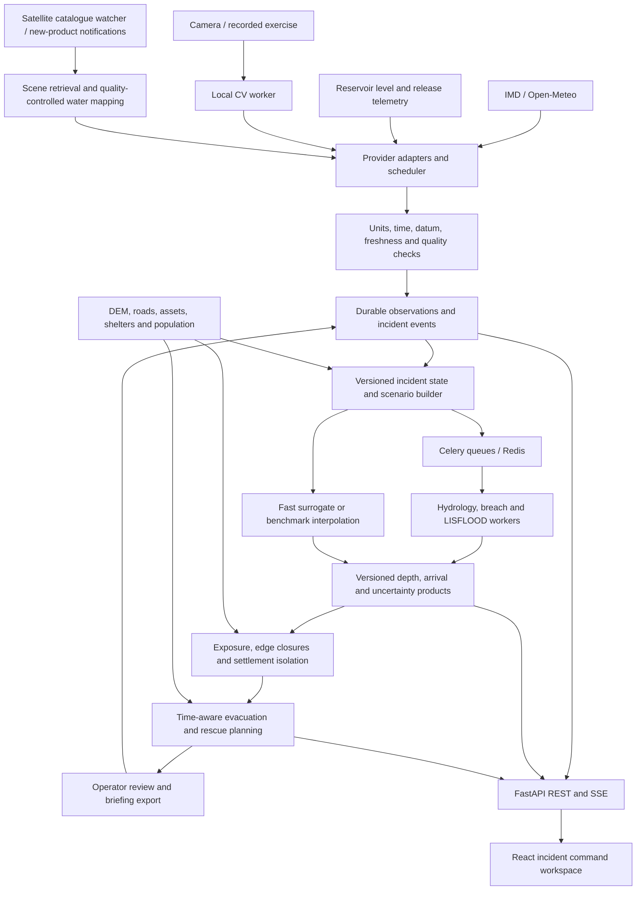
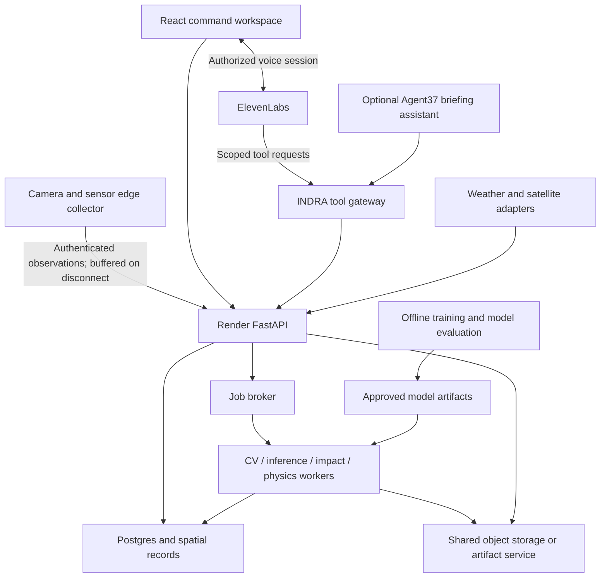
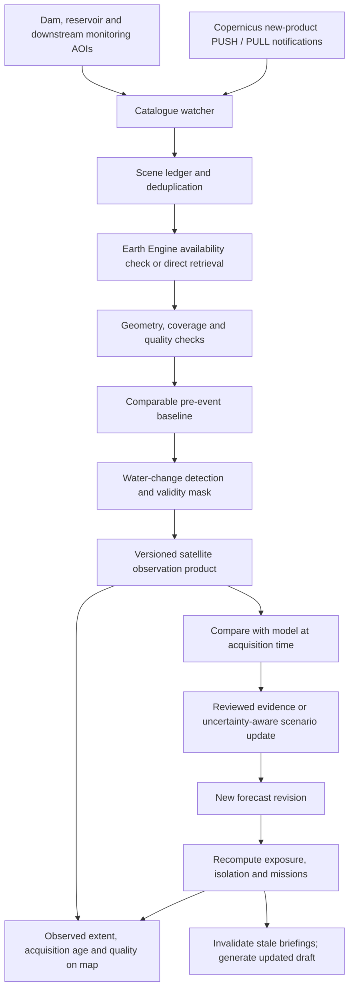

# INDRA incident monitoring and response architecture

Design date: 24 October 2026. Status: proposed architecture, not an implementation claim.

## Product and scope

Turn observations near one dam into updated downstream flood scenarios, isolation warnings, and operator-reviewed evacuation/rescue options. Start with the Tehri corridor. Support LIVE, REPLAY, and EXERCISE modes with conspicuous labels and one common analysis pipeline. Camera anomalies are evidence, not a structural dam-failure prediction.

Current foundation: React/Vite/Leaflet frontend, FastAPI backend, scientific scripts, stored V4 outputs, exposure and routing code, Earth Engine authentication and Sentinel-1 processing. Current Compose runs only frontend and backend. Database/worker scaffolding does not establish a deployed queue or durable incident system. No trained flood surrogate is established.

The older architecture.md describes the earlier Delft3D design. This proposal uses LISFLOOD-FP as the first downstream solver and retains DualSPHysics for selected offline near-field experiments. It does not claim the current V4 boundary inputs or accuracy are validated.

## Complete flow

## Credentials and existing configuration

Do not put private credentials in frontend VITE variables. Existing .env.example files contain placeholders, not proof of working integrations. New names below are proposed contracts until settings, adapters, deployment injection and tests are implemented.

| Service | Credentials/configuration | Current state and decision |
|---|---|---|
| Open-Meteo | No key for eligible free noncommercial access; proposed OPEN_METEO_API_KEY only for a paid integration | Build first weather adapter. Paid key also requires the appropriate customer endpoint. Cache requests and respect plan terms. |
| IMD | Request account/product access; proposed IMD_API_BASE_URL and IMD_API_TOKEN only if the approved product uses a token | Public API reference does not settle the authentication contract for our account. Confirm header, scope, quotas and products before implementing. |
| Google Earth Engine | Existing GEE_PROJECT_ID; local authorized-user authentication, or GEE_SERVICE_ACCOUNT and GEE_KEY_FILE | Backend auth implemented. Project must be registered/enabled with appropriate access. GOOGLE_APPLICATION_CREDENTIALS is an alternative SDK credential path where supported; do not require all methods simultaneously. |
| Cesium ion | Existing placeholder VITE_CESIUM_ION_ACCESS_TOKEN | Optional 3D terrain. Not consumed by the current frontend source inspected. Use a public read-only token restricted by assets and allowed URLs. |
| Camera | Proposed CAMERA_SOURCE; stream credentials stored separately | Webcam/file needs no cloud API key. RTSP credentials are secrets; redact URLs in logs. Build adapter and calibration. |
| Reservoir telemetry | Provider-specific identity/token or local device credentials | No universal dam-data key. Start with explicitly labelled exercise telemetry; integrate only an actual accessible source. |
| NASA Earthdata | Existing NASA_EARTHDATA_TOKEN | Optional GPM/IMERG extension. Existing service performs catalog/readiness checks, not a complete rainfall downloader. Public catalog success does not prove protected granule authorization. |
| Copernicus Data Space | Existing COPERNICUS_CLIENT_ID / COPERNICUS_CLIENT_SECRET placeholders | Proposed catalogue subscriptions and optional direct retrieval. Confirm authentication for the selected API; notification does not imply the scene is already ingested into Earth Engine. |
| CARTO | Existing VITE_CARTO_BASEMAP_KEY placeholder | No consumption found in inspected frontend; not a required key for the existing map. Choose tile hosting and terms explicitly. |
| Solver, local CV, local ML, NetworkX | No third-party API key | Require dependencies, model files and compute instead. |
| Postgres, Redis, artifact storage | DATABASE_URL, REDIS_URL; storage configuration | Internal infrastructure credentials, not weather/data API keys. |

Native backend settings read .env relative to the launch directory: use backend/.env when launching there. Frontend development uses frontend/.env. Compose root .env is interpolation input, not automatic injection of every variable into containers. Add new variables to Compose explicitly. Vite values are typically build-time values and are public in the bundle.

Current Compose passes GEE and Copernicus variables but not all backend settings (including NASA token). A container key-file path must refer to the mounted container path, not its host path. Keep private files out of Git; prefer application-default or workload credentials where feasible.

## Modules and contracts

| Module | Responsibility | Output |
|---|---|---|
| Provider adapters | Fetch/cache weather, sensor and satellite observations with retries/backoff | Normalized Observation records |
| Satellite watcher and worker | Discover new AOI acquisitions, deduplicate scenes, retrieve and process comparable observations | Timestamped water-extent product, validity mask, quality flags and provenance |
| CV worker | Waterline, rate of rise, visible overtopping and camera quality; calibrated camera geometry | Evidence frame, estimate, units, confidence and calibration version |
| Quality service | Normalize units, horizontal CRS, vertical datum and timestamps; flag stale/conflicting/missing data | Accepted or quarantined observation |
| Incident service | Fuse evidence conservatively, record overrides, select scenarios | Immutable state revision and evidence references |
| Scenario builder | Translate state into plausible release/breach parameter ranges | Input snapshot with assumption provenance |
| Prediction service | Select supported fast model; detect out-of-domain input | Fast estimate or explicit unsupported/pending state |
| Physics worker | Execute hydrology, breach and downstream solver jobs | Solver products, logs and numerical diagnostics |
| Impact worker | Intersect hazard with assets and sample entire road geometry | Affected assets, edge closure windows, isolated settlements |
| Mission planner | Evaluate outward/loading/return trips, shelters and capacities | Proposed missions, feasibility margins and alternatives |
| API and event stream | REST commands, job status, resumable SSE updates | Consistent run-version views |
| UI | Incident map, camera, timeline, evidence, comparison and missions | Operator workspace and exports |

An Observation carries id, source, source_record_id, mode, observed_at, issued_at, ingested_at, geometry, horizontal_crs, vertical_datum where relevant, variable, value, units, quality_flags and artifact reference. Forecast records also carry valid_time and model_run_id. Deduplicate by provider record/version; retain raw input for replay.

A PredictionRun carries run_id, incident_id, state_revision, mode, method, model_version, terrain_version, input_hash, input_snapshot, assumptions, parent_run_id, status, created_at, completed_at and diagnostics. Products reference exactly one run. Never combine old routes with a new flood layer without marking them stale.

Run states: QUEUED -> RUNNING -> SUCCEEDED / FAILED / CANCELLED. A successful job is not automatically scientifically accepted: record a separate QC verdict. New evidence supersedes old predictions; late workers must not overwrite the current revision. Use idempotency keys and coalesce rapid observations before costly recomputation.

## Prediction and training

1. Audit units, breach equations, SPH flux extraction, boundary distribution and V4 mass logs. Resolve the extreme depth/inflow discrepancies before generating labels.
2. Freeze one domain: conditioned DEM, CRS/datum, boundaries, roughness, road graph, inventory and simulation horizon.
3. Generate physically plausible scenario configurations with stratified or Latin-hypercube sampling. Choose run count after measuring solver runtime and storage, not an arbitrary large target.
4. Execute simulations and retain inputs, code/solver versions, logs, mass residuals and QA flags. Exclude or separately label invalid runs.
5. Store depth sequences, arrival times and validated velocity products where available. Unknown velocity stays unknown.
6. Split by complete scenario/event groups; keep a locked test set and out-of-range stress cases. Adjacent frames from one run must not cross splits.
7. Establish a nearest-scenario/interpolation baseline; train a spatial surrogate only if it improves accuracy/latency. Package normalization and domain metadata with weights.
8. Evaluate depth error, wet-area overlap, arrival error, missed road closures and end-to-end latency against held-out solver runs. Separately evaluate physical realism against observations where possible.
9. Deploy an approved version with input-range checks. Unsupported inputs trigger a physics job and an explicit pending/unsupported display, not confident extrapolation.

```mermaid
flowchart LR
    Configs[Scenario sampler] --> Solver[Corrected physics runs]
    Solver --> QA[Numerical and input QA]
    QA --> Dataset[Versioned dataset]
    Dataset --> Split[Scenario-level train / validation / test]
    Split --> Train[Baseline and surrogate training]
    Train --> Eval[Accuracy, latency and out-of-domain evaluation]
    Eval --> Registry[Approved model registry]
    Registry --> Inference[Online fast prediction]
```

Nonnegative depth and conservation penalties are useful constraints, not guarantees of accuracy. Maintain separate CV datasets with site/session-level splits, visibility tests and real held-out footage. Synthetic augmentation does not substitute for real camera evaluation.

The fast path uses approved surrogate inference or explicitly labelled scenario interpolation. The slower path performs selected hydraulic checks asynchronously. DualSPHysics need not run for every observation. Initial timing goals are hypotheses to benchmark on available hardware, not product guarantees.

Scenario spread is an uncertainty envelope, not automatically a calibrated probability. Earlier arrival quantiles are conservative for deadlines; label quantiles carefully and account for ensemble weighting before calling a fraction a probability.

## Impact and mission algorithms

Build a directed road graph with length, travel time, geometry, bridge identity, vehicle restrictions and hazard coverage. Sample along an edge rather than at one midpoint. Separate known closures, predicted closures and unknown coverage. Unknown does not mean safe.

Evaluate depth and, where available, velocity using explicitly configured vehicle/agency rules. Water intersection predicts exposure, not structural bridge failure or monetary damage.

For each edge traversal, require exit_time + margin < earliest relevant closure_time. Include departure time, mobilization, loading and return/extraction legs. Use a time-dependent earliest-arrival search under a documented monotone-closure/FIFO assumption; otherwise use a time-expanded graph. Search departure times for the last feasible departure.

Isolation is loss of feasible connectivity from a settlement to suitable shelters or response access, even while the settlement itself is dry. Rank critical bridges by changes in reachable population/assets, not raw centrality alone.

Prototype mission assignment uses an inspectable greedy baseline subject to team, vehicle, time and shelter-capacity constraints. Add constrained optimization only after validating that baseline. Show infeasible missions and the reason. Human approval produces a briefing/export; actual NDRF dispatch is a separate authorized integration and is not claimed.

## Persistence and deployment

Use a modular monolith rather than independent microservices for the hackathon. The list below describes local development; the Render mapping later in this document replaces shared local storage for cloud deployment:

- React/Vite/Leaflet frontend; optional Cesium incident view later.
- FastAPI process for API, access control and SSE.
- Postgres/PostGIS for incidents, observations, runs, assets, mission plans and audit records.
- Redis/Celery for work distribution, separate short inference and long solver queues; durable job status lives in Postgres.
- Shared local artifact storage initially, with an S3-compatible interface for later deployment. Store raster/video/model files here, not in relational rows.
- CV/inference workers and CPU solver workers; optional GPU training machine offline.
- A scheduler for source refresh at provider cadence. Camera processing can be faster than weather ingestion; satellite updates follow acquisition availability.

Objects: raw/{provider}/{date}/, incidents/{id}/runs/{run_id}/, datasets/{version}/, models/{version}/. A manifest records hashes, inputs and lineage. Store UTC timestamps; show IST with timezone labels in the UI.

Keep private services off public ports, authenticate operator mutations and device ingestion, and redact credentials. Record operator overrides and approvals. Track source freshness, worker failures, queue delay, model version, latency and failed QC.

Offline EXERCISE uses cached, licensed input snapshots and a replay clock. LIVE outages show stale/unavailable feeds; they must never silently switch to exercise observations.

## Proposed API surface

These routes are a design, not a statement that they exist today. Reuse existing scenario/run APIs where compatible.

| Route | Purpose |
|---|---|
| GET /api/sources/status | Provider freshness and configuration without secrets |
| POST /api/incidents | Create live/replay/exercise incident |
| POST /api/incidents/{id}/observations | Authenticated sensor/manual evidence ingestion |
| POST /api/incidents/{id}/predictions | Queue versioned scenario prediction; return run/job ID |
| GET /api/runs/{run_id} | Durable job and QC status |
| GET /api/runs/{run_id}/products | Raster/vector product references and provenance |
| GET /api/incidents/{id}/events | Resumable SSE; event ID and state revision |
| GET /api/runs/{run_id}/impacts | Exposure, road closure and isolation results |
| POST /api/runs/{run_id}/missions | Compute mission options for departure/team constraints |
| POST /api/missions/{id}/review | Record operator decision and comments |
| POST /api/incidents/{id}/replay | Control exercise/replay clock with auditable events |

## Interface and demo

Primary views: Monitor -> Incident -> Forecast -> Impact -> Missions -> Evidence. Keep a synchronized map/camera/timeline, selected run version, data age, assumptions and mode visible. Evidence explains why a warning changed. Animate computed fields; do not substitute decorative water motion for simulation.

Demo: baseline -> rising-water evidence -> revised flood scenarios -> dry village isolated -> last departure deadline -> proposed rescue -> injected bridge closure -> revised mission -> compare delayed response. Never describe estimated exposed population as observed casualties or people actually rescued.

## Delivery gates

1. Scientific baseline: reconcile V4 inputs/units and reproduce numerical metrics; preserve regression evidence.
2. Data plane: weather adapter, timestamped replay, durable incidents and one measured camera task.
3. Prediction: scenario generator, held-out evaluation, fast baseline and optional trained surrogate.
4. Impact: full-edge hazard sampling, unknown-coverage handling, isolation and return-trip feasibility.
5. Experience: incident UI, synchronized animation, evidence and comparison, offline exercise package.
6. Readiness: measure latency and errors on actual hardware; test stale data, retries, worker restart and superseded runs.

## Architecture revision: sponsor credits, voice and resilience

Scope remains architecture only. No accounts, services, deployments, credentials or model training are provisioned by this document. Assume “Agent 37” means agent37.com; confirm against the actual sponsor credit offer before depending on its entitlements. Credit amounts, expiry, supported products, GPU access and model-token inclusion are not known.

### Highest-value additions

| Addition | Architectural change | Acceptance evidence |
|---|---|---|
| Observation updates | Compare calibrated gauge/camera observations with model predictions; update state or scenario weights using documented error models | A new observation changes an estimate; rejected/occluded evidence does not spuriously change it |
| Isolation deadlines | Maintain time-varying connectivity and mission completion margins | Demonstrate a dry village losing its only exit before inundation |
| Critical crossing analysis | Remove candidate bridge/road edges and recompute access | Show which crossing causes the largest loss of reachable population or facilities |
| Counterfactual branches | Fork immutable incident snapshots with alternate departure/closure assumptions | Side-by-side results share the same baseline and differ only in declared interventions |
| Evidence-grounded voice | Natural-language tools read versioned computed results | Spoken numeric claims match tool output and identify the prediction time |
| Degraded operation | Edge buffering, source freshness, reconnect and labelled offline exercises | Disconnect camera/cloud/weather and show explicit degradation without fabricated live data |

Use simple, inspectable residual checks and scenario reweighting first. Do not present a camera-only waterline as reservoir elevation without calibration and vertical datum. Full state assimilation is later work requiring observation operators and uncertainty models; it is not achieved merely by prompting an LLM.

### Sponsor roles

Render hosts the application and durable control plane. Map React to a static site, FastAPI to a web service, workers to background workers, the scheduler to a scheduled job or single scheduler service, Postgres/PostGIS to a compatible managed database, and the Celery broker to a compatible Render Key Value service after checking configuration. Verify required PostGIS extension support and broker eviction/durability settings for the chosen plan.

Cloud artifacts must be accessible to API and workers through object storage with signed access, or through a dedicated artifact service that owns its persistent disk. Render disks are service-local, not a shared filesystem across services, and ordinary service filesystems are ephemeral. Object storage may require a separate provider/budget. Keep temporary job scratch files local and upload validated outputs atomically before marking a run complete. Do not assume credits provide GPU training; keep training off the request-serving path.

Agent37 is an optional sandbox for a briefing/research assistant, not the scientific source of truth. Public material advertises hosted agent runtimes and custom containers. Confirm API access and credit scope before implementation. Give the runtime narrowly scoped INDRA API tools, no direct database access and no raw camera credentials. It can draft an evidence-linked incident briefing, inspect discrepancies, or help summarize benchmark comparisons. Keep heavy solver execution on the controlled worker path until hardware, limits and repeatability have been measured. Model-provider charges may be separate from sandbox credits.

ElevenLabs provides spoken briefings and optional conversational access. Start with approved structured briefing text -> speech. Add push-to-talk querying after the text/tool path is reliable. Use a private agent and backend-generated signed session URL where applicable; never expose its API key in the browser. Test place names, numbers and Hindi/English output with the selected voice/model before claiming language quality.

### Cloud and voice topology

Avoid chaining two conversational planners for every spoken request. Initial voice uses ElevenLabs tools to reach the INDRA gateway directly. Agent37 handles optional asynchronous briefing tasks. If its output is voiced, send approved text to speech rather than starting a second reasoning conversation.

### Tool and evidence contract

Proposed allowlisted tools: get_incident_summary, get_source_freshness, get_prediction_evidence, list_isolated_settlements, explain_route, compare_existing_scenarios and draft_briefing. Tools return typed fields with incident_id, state_revision, run_id, generated_at, freshness, units, assumptions and evidence references. Tool failures return unavailable, not an invented estimate.

The assistant explains computed outputs; it does not calculate flood depth, manufacture closure times or choose unverified vehicle thresholds. Render numeric facts directly from tool results in the UI and in template-based emergency briefings. For open-ended conversation, validate structured numeric claims against returned facts; if validation fails, fall back to a factual template. Retrieved bulletins and uploaded reports are untrusted data, not instructions to execute tools.

Read-only queries are the default. Proposed writes such as a road closure or scenario change create a preview showing place, time, mode and affected incident; an authenticated operator commits the change. Tool authorization must be enforced server-side, not only in an agent prompt. Voice does not dispatch crews or issue public warnings automatically. Public alerting remains out of the hackathon core.

Briefing states: DRAFT -> REVIEWED -> AVAILABLE_FOR_PLAYBACK. Preserve author, source run, reviewer and language. A new incident revision marks affected briefings stale. Interrupted/reconnected speech must not resume outdated route instructions. Provide transcript, replay controls and a persistent mute option; speak meaningful changes rather than every sensor update.

### Edge and replay design

Run camera acquisition near the physical camera. Upload compact estimates and selected evidence frames instead of streaming all raw video through the API. Optional live video is a separately authenticated media path. Calibrate once per camera pose; detect movement and invalidate calibration when necessary. Local buffering retains event IDs and original observation timestamps; delayed uploads are never treated as current observations.

For a disconnected demo, the locally cached EXERCISE pipeline and textual briefings remain usable. Cached audio is keyed by approved briefing content and model/voice version. LIVE mode shows connection failure explicitly. Cache availability never permits an old mission to masquerade as a fresh recommendation.

Historical forecast replay admits only records whose issue/availability time precedes the replay clock. Later observations are evaluation targets. Counterfactual branches retain baseline evidence, independent run IDs and declared interventions, enabling fair immediate-versus-delayed response comparisons.

### Configuration additions (proposed, not wired)

- ELEVENLABS_API_KEY: backend secret; ELEVENLABS_AGENT_ID and ELEVENLABS_VOICE_ID: selected account resources, not substitutes for authentication.
- AGENT37_API_KEY / AGENT37_BASE_URL: provisional adapter names; map them to the actual provisioned API contract rather than guessing authentication headers.
- Artifact store endpoint, bucket and credentials: selected after storage decision; keep credentials backend-only and restrict signed downloads.
- Render deployment automation token: optional CI credential, not an application runtime dependency. Dashboard deployment needs no Render key in the application.
- Device identities: unique per edge collector, revocable and scoped to observation ingestion.

### Credit and implementation priorities

Spend Render credits first on a reliable API, durable database and bounded worker capacity. Spend ElevenLabs credits on a concise, useful voice demo and pronunciation checks. Use Agent37 credits for one isolated, evidence-linked briefing assistant if the sponsor API fits; its outage must not block prediction or routing.

Limit concurrent solver jobs, per-job duration and artifact size; cache duplicate input hashes. Measure inference latency, queue wait, physics runtime, storage growth and voice usage before increasing scope. Sponsor credits do not imply free model tokens, unlimited data access or suitable GPU hardware.

Core demo sequence: sensor anomaly -> uncertainty-aware prediction -> isolation deadline -> ask “Why is this village prioritized?” -> evidence-backed spoken answer -> change a bridge condition -> updated mission and briefing. Show a separate immediate-versus-delayed response comparison. The advantage is the observation-to-decision loop, not the number of agents or APIs.

## Satellite monitoring and continuous incident updates

Satellite monitoring is a core input to LIVE mode. The platform automatically discovers and processes newly available acquisitions; it does not promise continuous satellite imagery. Acquisition opportunities, provider publication, cloud/terrain quality and processing all affect usable observation latency. Camera/sensor updates and model forecasts continue between satellite acquisitions.

### Observation roles

| Source | Intended role | Limitations recorded with every product |
|---|---|---|
| Sentinel-1 GRD SAR | Primary satellite water-change observation, including cloud-covered conditions | Terrain shadow/layover, vegetation, urban scattering, speckle and acquisition geometry can obscure or mimic water; not a direct flood-depth or structural-damage measurement |
| Sentinel-2 optical | Complementary visible-water extent and before/after imagery | Clouds, cloud shadows and illumination; unusable pixels remain unknown |
| Satellite precipitation such as GPM/IMERG | Optional catchment forcing and rainfall context | Product-specific latency/resolution; not a road-scale flood observation |
| Cameras and gauges | Frequent local observations between overpasses | Calibration, visibility, datum and connectivity |

Do not infer dam breach, road destruction, bridge collapse or casualties from a water mask alone. A satellite extent can support inundation evidence at acquisition time. Road traversability remains a modelled/observed evidence assessment with coverage and resolution limits.

### Acquisition-to-action pipeline

Start by scheduling the existing Earth Engine processing path with AOI/date filters and durable scene bookkeeping. For lower discovery delay, add Copernicus catalogue subscriptions where account access permits. These notify catalogue publication, not a satellite passing overhead. A discovered Copernicus scene may not yet exist in Earth Engine: track WAITING_FOR_PROCESSOR_INGESTION with retries, or use a separately implemented direct-data processing adapter. Never claim the two providers have identical ingestion times or silently apply unverified preprocessing.

Proposed discovery policy: configurable polling, initially every 15 minutes during an incident and hourly in background monitoring, adjusted to quotas and observed availability. These are catalogue-check intervals, not guaranteed image refresh periods. Prefer notifications where supported, plus periodic reconciliation to recover missed notifications. A failed provider request uses exponential backoff and an explicit degraded status.

### Processing and quality

1. Filter acquisitions by AOI intersection, instrument mode/product type, polarization, orbit and usable coverage. Use the minimum necessary spatial subset.
2. Select a pre-event baseline without future leakage; favor compatible relative orbit/viewing geometry and account for seasonal/permanent water. Preserve exact scene IDs and baseline policy.
3. For SAR, extend the existing bitemporal backscatter-drop/Otsu workflow with applicable terrain and quality masks, connected-component filtering and uncertainty flags. Record preprocessing already supplied by the source to avoid double processing.
4. For optical, use a separately evaluated water-index/segmentation path with cloud and shadow masks. Never fill masked areas as dry.
5. Produce water extent, valid-observation mask, quality flags and confidence only where calibrated. Store water polygons and georeferenced rasters with timestamps; partial AOI coverage remains explicit.
6. Compare against the forecast frame matching acquisition time, not the current clock. Evaluate overlap metrics only over common valid coverage. Large disagreement raises a diagnostic; it does not automatically replace physics with an uncertain image classification.
7. Incorporate accepted observations through a versioned state/scenario update with uncertainty. Recompute dependent products and retain the earlier forecast for evaluation. Late imagery is out-of-sequence evidence, not a current water mask.

A before/after composite may span several acquisition times. Show its time range; use individually timestamped scenes for fast-event comparisons where possible. Do not treat a multi-day composite as a single instantaneous flood footprint.

### Temporal and persistence contracts

Extend the scene ledger with provider, collection, scene_id, processing_version, geometry, acquisition_start, acquisition_end, provider_published_at where available, discovered_at, processing_started_at, processed_at, relative_orbit, polarization, baseline_scene_ids, valid_fraction, quality_flags, artifact_hash and related observation/run IDs. Use provider/scene/version/processing-config hash for idempotency. Cross-provider copies of one acquisition must not count as independent evidence.

Lifecycle: DISCOVERED -> WAITING_FOR_AVAILABILITY or QUEUED -> PROCESSING -> ACCEPTED / REJECTED / FAILED. Rejected scenes retain diagnostic metadata. Newer results are published atomically; duplicate notifications or worker retries do not trigger duplicate forecasts. Delayed scenes never overwrite newer observed layers solely because they finished processing later.

Track separately:

- Observation age: now minus acquisition time.
- Discovery/publication delay: discovery or publication time minus acquisition time.
- Processing delay: processed_at minus processing_started_at.
- Decision update delay: new prediction publication minus accepted observation time.

If a timestamp is unavailable, store unknown instead of inferring an exact latency. Display expected next acquisition only from a verified scheduling source; otherwise show unknown.

### UI, API and demo behavior

The map has separate Satellite-observed, Model-predicted and Camera/gauge evidence layers. Show acquisition timestamp, processing timestamp, usable coverage and stale/partial/rejected status. Basemap imagery is not a live satellite observation. Do not animate interpolated imagery as observed frames.

Proposed routes: GET /api/satellite/scenes, GET /api/satellite/observations/{id}, POST /api/satellite/subscriptions and a provider-specific authenticated notification endpoint when using PUSH. Acknowledge/queue notifications quickly; validate payloads and confirm referenced products via the trusted catalogue before processing. Never download arbitrary callback-supplied URLs. SSE publishes satellite.scene_discovered, satellite.observation_ready, satellite.observation_rejected and incident.prediction_revised, carrying IDs and revision numbers rather than image payloads.

Demo: replay a real acquisition/publication sequence and show observed water beside the prediction at the matching time, followed by a revised incident estimate. Exercise data is labelled. Satellite imagery from a real event cannot validate a hypothetical Tehri breach. If no new usable live acquisition exists during judging, show the latest actual scene with its age and continue real-time local sensing/model updates without inventing an overpass.

### Deployment and acceptance

Render hosts the catalogue scheduler, notification receiver, scene ledger and satellite worker queue. Earth Engine executes the configured remote processing; direct retrieval requires separately provisioned processing/storage. Use job limits and AOI subsets to control cost. Agent37 may summarize accepted evidence; ElevenLabs speaks only the current approved briefing, including observation age when material.

Test duplicate notifications, delayed GEE availability, missing baseline, cloud/terrain-invalid pixels, partial footprint, expired credentials, worker restart, out-of-order scenes, conflicting evidence and replay leakage. Measure discovery-to-map latency separately from acquisition-to-availability latency. Satellite absence must not block camera-driven incident updates, and satellite disagreement must remain visible.

## Provider references

- IMD account portal: https://api.imd.gov.in/public/index.php
- IMD products: https://api.imd.gov.in/public/api_reference.html
- Open-Meteo terms/access: https://open-meteo.com/en/pricing
- Historical forecasts: https://open-meteo.com/en/docs/historical-forecast-api
- Earth Engine credentials: https://developers.google.com/earth-engine/guides/service_account
- Cesium token scopes and restrictions: https://cesium.com/learn/ion/cesium-ion-access-tokens/
- Render service types: https://render.com/docs/service-types
- Render workers: https://render.com/docs/background-workers
- Render storage limitations: https://render.com/docs/disks
- Agent37 platform (assumed sponsor identity): https://www.agent37.com/
- ElevenLabs voice sessions and authentication: https://elevenlabs.io/docs/eleven-agents/libraries/web-sockets
- Copernicus new-product subscriptions: https://documentation.dataspace.copernicus.eu/APIs/Subscriptions.html
- Earth Engine dataset ingestion status: https://developers.google.com/earth-engine/datasets/status

References checked on the design date. Access and quotas must be confirmed for the actual account before deployment.
