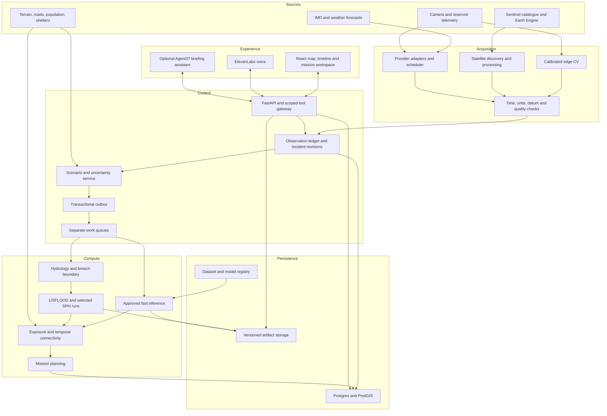
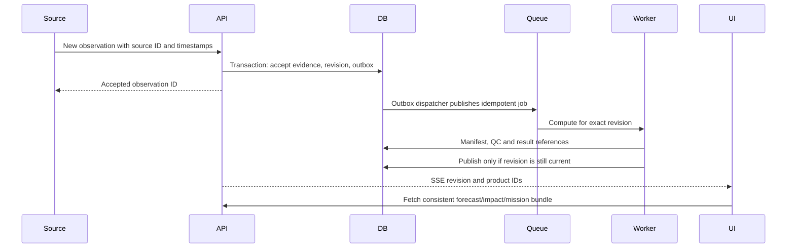

# INDRA: continuous flood intelligence and response system

Status: proposed target design. Date: 24 October 2026. This document specifies the system to build; it does not claim these capabilities are deployed or validated.

## 1. Mission and product boundary

INDRA converts weather, satellite, camera and reservoir observations into continuously revised flood scenarios, infrastructure disruption estimates and feasible evacuation/rescue options. Its defining output is the interval during which a community remains reachable, including communities that are dry but losing road access.

Design for multiple dams and incidents, but qualify models and data separately for every geographic domain. Start acceptance testing with one corridor. Disaster triggers may include extreme rainfall, earthquake reports, landslide blockage or observed abnormal release; a trigger creates evidence and scenarios, not proof of structural failure. Dam-failure probability requires a separately validated structural/geotechnical model and suitable instrumentation.

Three operating modes share the same interfaces: LIVE observations and forecasts; REPLAY using data available before a historical clock; EXERCISE with explicit synthetic inputs. Mode is immutable on an incident. Never silently mix exercise observations into a live incident.

### Core journeys

1. Operator monitors a dam, source freshness and evidence quality.
2. New evidence creates a versioned incident state and plausible release scenarios.
3. A fast predictor updates flood extent/depth/arrival envelopes; selected physics jobs check them asynchronously.
4. Impact analysis estimates road closure windows, infrastructure exposure and settlement isolation.
5. Mission planning incorporates departure, mobilization, loading, return/extraction and shelter capacity.
6. Operator compares alternatives, reviews a briefing, and exports it. Public warning/dispatch is a separately authorized future integration.
7. New observations revise forecasts and invalidate outdated mission recommendations and briefings.

## 2. Architecture



Logical boundaries are explicit, but initial deployment is a modular monolith plus independently scheduled workers. Split a module into a network service only when measured scaling, isolation or ownership demands it. Agent frameworks are not part of the hydraulic execution or route feasibility algorithms.

## 3. Component ownership and interfaces

| Component | Owns | Consumes | Produces |
|---|---|---|---|
| Acquisition | Provider state, polling cursors, retries | External APIs and device messages | Raw artifacts and observations |
| Satellite | Scene ledger, baseline selection, quality masks | New scenes and monitoring AOIs | Observed water products |
| CV | Camera calibration and perception version | Frames, calibration targets | Waterline/rise estimates and evidence |
| Incident | Evidence acceptance and revision ordering | Accepted observations, operator input | Immutable state snapshots |
| Scenario | Assumptions and parameter ensembles | State and domain configuration | Reproducible run inputs |
| Prediction | Method selection and support checks | Scenario snapshot, model registry | Fast products or unsupported status |
| Physics | Solver lifecycle and numerical diagnostics | Boundary and terrain artifacts | Validated-format simulation products |
| Impact | Spatial intersections and closure envelopes | Hazard products and inventories | Exposure and isolation products |
| Mission | Resource and time constraints | Closure windows, shelters, teams | Feasible/infeasible options and margins |
| Briefing | Drafts, review and stale status | Versioned computed facts | Text/audio/export artifacts |
| Registry | Approved datasets/models/domains | Evaluation packages | Immutable deployable versions |

## 4. Persistence model

All records include tenant/project ownership where applicable. UUID identifiers are not authorization. Store UTC internally and display timezone-labelled IST. Use projected CRS for metric calculations; record horizontal CRS and vertical datum independently.

| Entity | Important fields and invariants |
|---|---|
| DomainVersion | dam_id, boundary, DEM/roughness/graph hashes, CRS, datum, solver configuration; immutable |
| Source | provider, product, scope, refresh policy, credential reference, freshness policy; no raw secret in records |
| Observation | source_record_id, observed_at, issued_at, valid_time, ingested_at, value/geometry, units, quality, mode, artifact_id |
| SatelliteScene | provider ID/version, acquisition interval, orbit, polarization, footprint, availability and processing timestamps |
| CameraCalibration | camera_id, pose/reference mapping, datum, calibration version, validity period |
| Incident | mode, domain_version, current_state_revision, lifecycle and ownership |
| IncidentRevision | revision number, accepted evidence IDs, assumption snapshot, replay clock, creator; immutable |
| Scenario | input parameters, uncertainty interpretation, sampling seed, parent revision |
| PredictionRun | scenario, method/model/solver versions, input hash, status, QC verdict, supersedes ID |
| Artifact | URI, checksum, media type, size, spatial bounds, temporal extent, manifest and ACL |
| ImpactSnapshot | run_id, inventory/graph versions, coverage, closure assumptions, output artifacts |
| MissionPlan | impact_id, team/vehicle/shelter versions, departure and loading assumptions, result, expiration |
| Briefing | source revision/run/mission IDs, language, factual payload, review status, text/audio hashes |
| AuditEvent | actor, operation, time, before/after references, request ID |
| OutboxEvent | event ID, aggregate/revision, payload reference, publication/retry status |

Use B-tree indexes for incident/revision/time and GiST indexes for geometry. Partition high-volume observations by time only after measurement. Keep large arrays, video and model weights in artifact storage. Record a retention class: scientific reproducibility, incident evidence, temporary scratch or approved export. Never delete reproducibility inputs as ordinary scratch cleanup.

## 5. Event and execution semantics

Use at-least-once delivery with idempotent consumers. Commit state changes and outbox events in one database transaction; a dispatcher publishes outbox entries to the broker. Acknowledge work only after durable progress. Do not claim exactly-once delivery.

Example event envelope (illustrative values):

```json
{
  "schema_version": 1,
  "event_id": "uuid",
  "type": "satellite.observation.accepted",
  "incident_id": "uuid",
  "state_revision": 12,
  "mode": "LIVE",
  "occurred_at": "2026-10-24T10:00:00Z",
  "recorded_at": "2026-10-24T10:04:00Z",
  "correlation_id": "uuid",
  "causation_id": "uuid",
  "payload_ref": "observation:uuid"
}
```

Work queues: ingestion, satellite, inference, physics, impact, mission and briefing. Separate worker concurrency for long physics and short interactive jobs. Deduplicate by input hash plus code/model/domain version; cache only exact compatible results. Coalesce noisy observations using explicit change thresholds and maximum update delay.

Run lifecycle: QUEUED -> RUNNING -> SUCCEEDED/FAILED/CANCELLED. Track scientific QC independently as PENDING/PASS/FAIL/REVIEW. Lease/heartbeat workers; reconcile abandoned jobs on restart. Support timeout, cancellation, bounded retries and a diagnostic dead-letter state. A failed scientific QC is not retried indefinitely as a transient network error.

Upload artifacts to temporary locations, verify hashes and manifest, then atomically publish the result pointer. Compare-and-swap the incident's current result revision so late jobs cannot supersede newer results. Preserve late results for audit/evaluation.



## 6. Satellite, weather and edge sensing

Monitor reservoir and downstream AOIs for new Sentinel-1 acquisitions, with Sentinel-2 as cloud-limited corroboration. Use Earth Engine first; add Copernicus catalogue notifications and direct processing only with tested access and preprocessing parity. Catalogue publication does not mean immediate Earth Engine ingestion.

Satellite pipeline: discovery -> deduplication -> availability -> quality/baseline checks -> water-change extraction -> validity mask -> observation acceptance -> model comparison at acquisition time -> revision. Preserve unknown pixels, terrain shadow/layover, partial coverage and baseline limitations. Water extent is not direct depth, structural damage or road traversability.

Record acquisition, publication when available, discovery, processing and decision-update times separately. Polling every 15 minutes is a proposed discovery policy, not a 15-minute satellite revisit guarantee. A late scene is out-of-sequence evidence. Do not relabel it as current or compare it blindly with the present forecast.

Weather adapters retain provider/model run, issue/valid times, grid footprint, units and accumulation periods. Integrate catchment-weighted precipitation, not a single city forecast used as basin rainfall. Separate reanalysis hindcasts from archived forecast evaluation. Missing intervals are flagged; any imputation policy is versioned.

Edge CV estimates waterline, rise rate, visible overtopping and camera health. Calibrated references and pose validity are mandatory for metric levels. Buffer signed/authenticated observation messages locally on disconnect; retain original timestamps. Raw video uses a separate optional media path. Earthquake/landslide alerts may trigger scenario review but cannot determine breach geometry automatically.

## 7. Physics and machine learning

Hydrology estimates inflow; reservoir continuity and explicit breach/release assumptions produce boundary hydrographs. Check SI units, stage-storage assumptions, datum, injected volume and distributed-boundary totals before execution. Near-field DualSPHysics is an offline/selected refinement path; qualify when its scaled output is compatible with the downstream solver. Initial downstream integration uses LISFLOOD-FP with a documented applicability envelope; compare against a suitable full-momentum reference for rapidly varied cases before making accuracy claims.

A physics run manifest includes input hashes, solver binary/version, configuration, timestep policy, boundary series, terrain, roughness, numerical diagnostics and limitations. Separate numerical conservation, solver verification, observational calibration and physical validation in the product.

Training pipeline:

1. Qualify a reproducible domain and solver baseline.
2. Sample plausible head, breach width/time, inflow, roughness and downstream conditions; record parameter dependencies and priors.
3. Execute jobs with conservation, geometry and stability checks; retain rejected-run diagnostics.
4. Build depth sequences, arrival products and valid masks; include velocity only where available and qualified.
5. Split complete scenarios/events into train/validation/test; keep independent out-of-distribution tests.
6. Compare simple interpolation/retrieval baselines with learned spatial models. Select model family based on measured accuracy, memory and latency.
7. Package model, preprocessing, units, domain/input envelope, test metrics and training lineage.
8. Require model approval and rollback support. Unsupported inputs request physics work instead of confident extrapolation.

Potential loss terms combine supervised depth/arrival errors, nonnegative-depth penalties and physically appropriate volume residuals. Physics penalties are not a substitute for boundary correctness. Synthetic solver labels establish surrogate agreement with that solver, not real-world truth.

Observed water/gauge updates initially use explicit residual checks and scenario reweighting. Full assimilation requires a defined observation operator and error covariance; later consider an ensemble method after validation. Keep observations used for assimilation separate from held-out evaluation. Ensemble proportions are not calibrated probabilities unless validated as such.

## 8. Impact and rescue decision model

Derive time-indexed road hazard from full edge geometry, not a single midpoint. Account for road elevation/bridge deck data when known; a flooded cell beneath a bridge does not prove deck inundation. Unknown coverage remains unknown.

Exposure is intersection of hazard and inventory. Isolation is loss of feasible connectivity to appropriate shelters or access points. Evaluate critical crossings through the change in reachable population/assets after removing an edge, not centrality alone.

For departure time d and edge travel duration tau, require traversability over the complete traversal interval, with configured uncertainty margin. Include mobilization/loading/extraction. Use a time-dependent earliest-arrival algorithm only under stated FIFO/closure assumptions; use time-expanded search when reopening/waiting makes those assumptions invalid.

Mission assignment constrains available teams, vehicle capability, shelter capacity, service times and return feasibility. Start with an inspectable greedy baseline; compare against a constrained optimizer for small test cases. Report unmet demand and infeasible missions rather than inventing a feasible alternative. Estimated population exposure is not a casualty estimate.

Counterfactuals fork a frozen evidence snapshot and change declared interventions only. Compare last departure, mission margin, reachable capacity and isolated population estimates, with inventory uncertainty displayed.

## 9. API and assistant boundary

All proposed paths below are design contracts. Preserve/adapt existing routes during implementation with explicit versioning rather than silently breaking clients.

| Interface | Contract |
|---|---|
| POST /api/v2/incidents | Create mode/domain-scoped incident |
| POST /api/v2/incidents/{id}/observations | Authenticated evidence; idempotency key |
| GET /api/v2/incidents/{id}/snapshot | Consistent revision and result references |
| POST /api/v2/incidents/{id}/predictions | 202 with run ID; optional expected revision |
| GET /api/v2/runs/{id} | Status, QC, diagnostics, provenance |
| GET /api/v2/runs/{id}/products | Authorized artifact references |
| GET /api/v2/runs/{id}/impacts | Exposure, closures and coverage |
| POST /api/v2/runs/{id}/missions | Resource/departure constraints; asynchronous if needed |
| POST /api/v2/incidents/{id}/branches | Immutable counterfactual baseline and interventions |
| GET /api/v2/incidents/{id}/events | Resumable SSE with event ID and revision |
| GET /api/v2/satellite/scenes | Discovery/processing/freshness status |
| POST /api/v2/briefings/{id}/review | Operator decision with expected revision |
| POST /api/v2/voice/session | Short-lived authorized voice session |

Standard errors include code, message, retryable, correlation_id and field errors; never credentials. Use 409 for revision conflicts, 422 for invalid scientific inputs and 429 with retry guidance for rate limits. Paginate observations/events; expose signed short-lived artifact URLs and range-friendly rasters. On an expired SSE cursor, require a fresh snapshot.

ElevenLabs calls a scoped tool gateway for read-only incident facts, source freshness, route explanations and existing scenario comparisons. Server-generated private sessions keep API keys off the client. Start with approved text-to-speech briefings; validate language, place names, units and numbers before conversational expansion.

Agent37 is an optional asynchronous briefing/evidence assistant, assuming the sponsor is agent37.com. It receives authorized API tools, not direct database access or raw credentials. Do not chain it into every voice query. Neither assistant invents flood values or executes public dispatch. Writes produce a concrete preview and require authenticated operator action. Retrieve documents as untrusted data.

## 10. Render deployment and artifacts

| Workload | Initial placement |
|---|---|
| React frontend | Render static site |
| FastAPI / SSE / notification receiver | Render web service |
| Short inference, impact and mission jobs | Render background workers with bounded concurrency |
| CPU hydraulic jobs | Dedicated worker class; evaluate runtime/memory first |
| Scheduler | One scheduler process or scheduled job with lease to prevent duplicates |
| Incident database | Managed Postgres with required PostGIS support verified |
| Job broker | Compatible Render Key Value service, configured for queue requirements |
| Rasters/video/models | Shared object storage or a dedicated artifact service |
| GPU training | Separate hardware/provider if required; sponsor GPU credits are not assumed |
| Camera acquisition | Local edge device or laptop |

Render disks are service-local; do not mount one logical shared filesystem across API and workers. Ordinary container filesystems are temporary. A dedicated artifact service may own a disk, but it needs authenticated transfer and is a single-service availability boundary. Prefer object storage for scalable artifact access.

Deploy immutable images and pinned model versions. Database migrations are backward-compatible and run once before compatible application rollout. Restore tests cover database plus artifact manifests. Worker shutdown checkpoints or releases leases; resumed jobs verify inputs and partial outputs before reuse. Keep a previous model/application image for rollback.

Secrets are environment/secret-manager references. Browser-visible map tokens are narrowly scoped. Keep cloud deployment tokens in CI only. Provider products, quotas, credit expiry and model-token costs must be checked against actual accounts before choosing paid resources.

## 11. Performance, capacity and reliability targets

These are engineering acceptance targets to measure, not claims about current hardware or accuracy. Initial test profile: one active corridor, 1–3 cameras, 10 concurrent dashboard users, one concurrent heavy solver job and a bounded inference queue. Expand only after load measurement.

| Operation | Initial target |
|---|---|
| Cached incident/snapshot request | p95 below 1 second under the test profile |
| Accepted event to dashboard notification | p95 below 2 seconds, excluding upstream acquisition |
| Supported fast forecast plus impact refresh | p95 below 15 seconds on qualified domain/hardware |
| Replay interaction | Deterministic outputs for a fixed snapshot/model version |
| Physics/satellite processing | Report measured duration and queue time; no fixed real-time guarantee |
| Recovery rehearsal | Restore selected incident, manifests and models within 60 minutes in staging |

Track upstream delay, queue delay, processing time and UI publication separately. Timeouts return a pending job, not a fabricated result. Database remains source of truth if the broker loses queued work; a reconciler re-enqueues eligible durable jobs.

Capacity planning uses measured values: artifact bytes approximately equal scenario_count * frame_count * rows * cols * channels * bytes_per_value before compression. For illustration, 100 scenarios * 61 frames * 1000 * 1000 cells * one float32 channel is about 24.4 GB before masks, metadata or replicas. Do not commit such generated data to Git. Crop/tiling/compression and retention policies must preserve reproducibility requirements.

## 12. Failure handling and observability

| Failure | Required behavior |
|---|---|
| Weather API stale/unavailable | Keep last timestamped value, flag stale, use explicit approved fallback or unsupported state |
| Camera moved/occluded | Invalidate metric calibration, preserve quality event, avoid false water-level update |
| No satellite acquisition / clouds / terrain masks | Retain last acquisition age and unknown coverage; continue local monitoring |
| Duplicate/out-of-order scene | Deduplicate; compare at acquisition time; do not overwrite newer layer |
| Surrogate unsupported | Queue physics or show unsupported; suppress false precision |
| Solver QC failure | Keep diagnostics, do not publish as accepted hazard |
| Queue/worker interruption | Durable reconciliation, leases and idempotent retry |
| New incident revision during mission computation | Mark old result stale and request latest bundle |
| Voice/Agent37 outage | Core map and deterministic text remain usable |
| Cloud outage | Label offline EXERCISE explicitly; never present cached missions as fresh live recommendations |

Metrics: source age, valid coverage, ingest errors, queue age, job failure/QC rates, runtime/memory, model support rejection, forecast revision lag, missed-closure evaluation, mission infeasibility, voice latency/usage and artifact growth. Trace correlation IDs across observation -> run -> mission -> briefing. Logs redact tokens, RTSP passwords and signed URLs.

Access roles: viewer, analyst, operator and administrator; device accounts only ingest permitted sources. Apply incident ownership checks on every API/tool/artifact route. Audit overrides and review actions. Validate provider notifications against trusted catalogue records before retrieval; do not fetch arbitrary callback URLs. Bound uploads, job parameters and compute concurrency.

## 13. Verification and scientific acceptance

| Layer | Evidence required |
|---|---|
| Data | Unit/datum/time validation, missingness, original source and reproducible transforms |
| CV | Held-out camera/session evaluation, waterline/level errors, occlusion/movement detection |
| Physics | Analytical/suitable published reference cases, water balance, timestep/grid sensitivity, boundary accounting |
| Hydrology | Event-level calibration and independent event validation, full hydrograph metrics |
| Surrogate | Held-out scenario depth/arrival/extent errors, out-of-range rejection, latency and closure errors |
| Satellite | Water detection quality over valid pixels, scene-aligned comparison, independent references where available |
| Routing | Small-graph oracle comparisons, closure during traversal, bridges, unknown coverage, return trip and capacity |
| Distributed execution | Retry, duplicate event, out-of-order result, interrupted worker and restore exercises |
| UI/voice | Consistent revision, numeric grounding, stale warnings, mode labels and pronunciation |

Define thresholds before evaluating the locked test set. No single conservation percentage establishes physical accuracy. Do not use assimilated observations as independent validation targets. Maintain benchmark cards describing geography, assumptions, data availability and failures.

## 14. Build programme and decision records

Phase A: domain/physics qualification and durable incident contracts. Exit: reproducible scientific baseline and revision semantics.

Phase B: weather, camera, satellite discovery and replay. Exit: timestamped evidence changes state; missing data produces explicit degraded behavior.

Phase C: synthetic scenario generation and qualified fast inference. Exit: held-out evaluation and unsupported-input behavior.

Phase D: exposure, isolation and complete rescue missions. Exit: small-case correctness and inspectable feasibility explanations.

Phase E: Render deployment, voice and optional Agent37 briefing. Exit: a synchronized live/exercise demo, restore rehearsal and budget measurements.

Phase F: multi-domain expansion and advanced assimilation/optimization only after domain-specific qualification.

Decisions: modular monolith first; Postgres source of truth; at-least-once workers; object artifacts; fast/physics separation; periodic satellite observations with continuous incident updates; deterministic numerical tools beneath language interfaces; human-reviewed response plans.

Open implementation decisions: hackathon deadline/team/credit entitlements; actual dam telemetry access; qualified terrain and reservoir data; satellite product access; model/hardware runtime; artifact provider; domain-specific acceptance thresholds. These do not block interface design but must be resolved before operational or performance claims.

## 15. Supporting documents

- [Detailed sponsor, credentials, satellite and demo architecture](hackathon_architecture.md)
- [Repository structure](repository_structure.md)
- [Validation strategy](validation_strategy.md) — describes intended tiers; verify completed evidence separately.

Provider capabilities referenced here are linked in hackathon_architecture.md. This PR is architecture documentation only; runtime integration requires subsequent implementation and tests.
